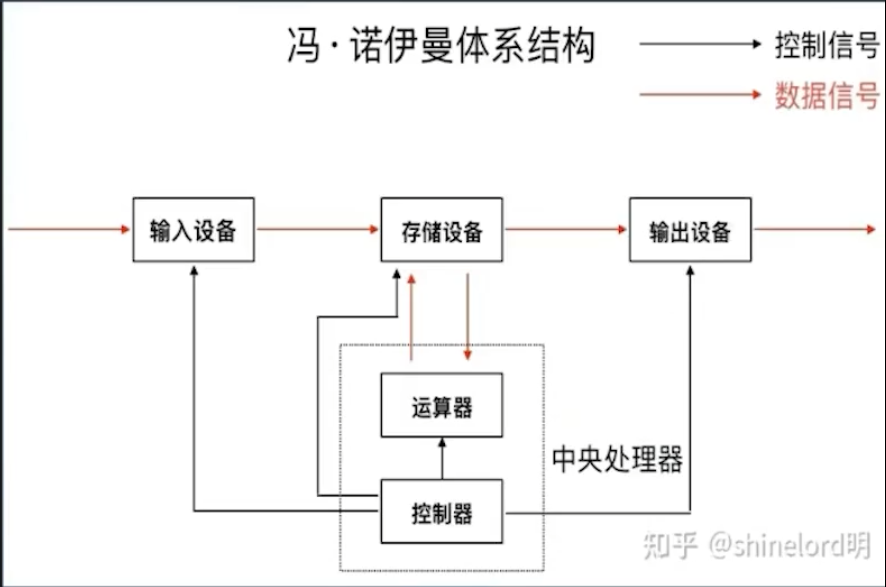
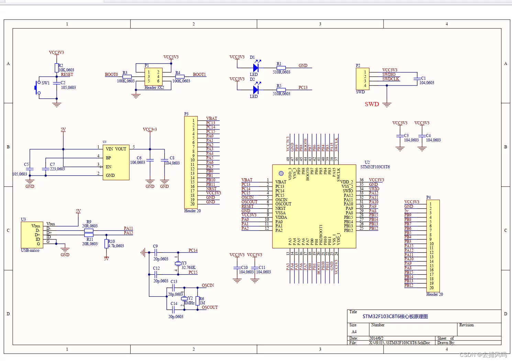
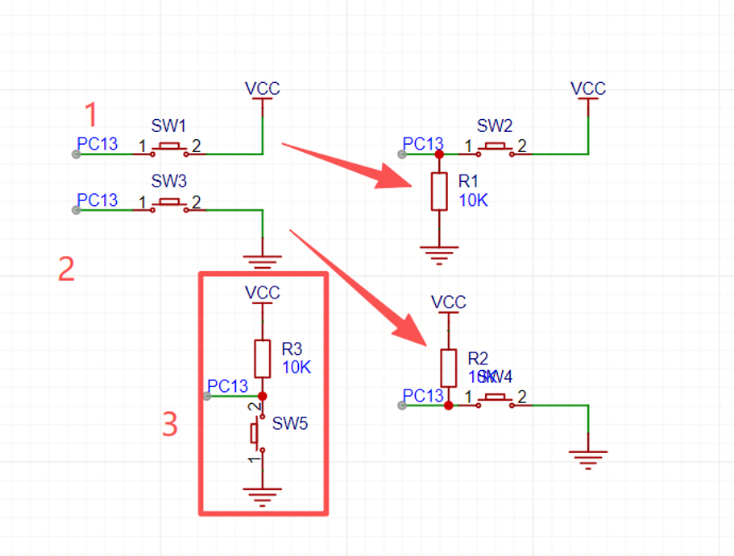
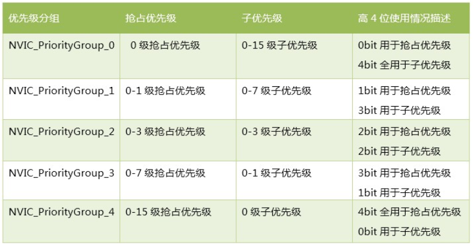

# 第一周

## 基础



RAM：内存，速度快，断电数据没有。

ROM：只读，只能烧录写入。Flash是ROM的一种，代码存放在ROM/Flash中。

连接烧录器提供的3.3v供电电流不太行，用电器多后需要插usb供电。usb供电为5v，经过降压后会给单片机使用。

单片机上有一个复位按钮，可以让单片机重新启动。



SWD整体性能比JTAG好，且节约板子尺寸，但是只能用于ARM内核的单片机。

## GPIO

GPIO是MCU与外部元件沟通的接触点，一般沟通的是电压信息，俗称引脚。

引脚工作模式主要有下面几种：
输入
- 下拉输入
- 上拉输入
- 浮空输入
- 模拟输入

输出
- 推挽输出
- 开漏输出
- 复用推挽输出
- 复用开漏输出

### 输入



### 下拉输入

即前图中的1变化后的电路图。使得SW2按下时为高电平，松开时为低电平。

### 上拉输入

即前图中的2变化后的电路图。使得SW3按下时为低电平，松开时为高电平。

上拉的电源一定要加电阻限流，大约是10k的量级。

### 浮空输入

前图中的1/2原图，按键松开时不能准确确定电平状态，即为浮空输入。

### 模拟输入

前面的模式都是只能读取高（3.3v）/低电平，这是数字信号，只有1/0。如果要读取0-3.3v中间的电压信号，就需要模拟信号，后续的ADC会学习。

### 输出

#### 推挽输出

只能输出小电流。

#### 开漏输出

输出电流电压由外部供电决定。

#### 复用推挽输出和复用开漏输出

后续学习再涉及。

### GPIO函数

#### ReadPin

读取信号。

函数原型：

```c
GPIO_PinState HAL_GPIO_ReadPin(GPIO_TypeDef *GPIOx, uint16_t GPIO_Pin);
```

#### WritePin

写信号。

函数原型：

```c
void HAL_GPIO_WritePin(GPIO_TypeDef *GPIOx, uint16_t GPIO_Pin, GPIO_PinStatePinState);
```

#### TogglePin

翻转信号。

函数原型：

```c
void HAL_GPIO_TogglePin(GPIO_TypeDef *GPIOx, uint16_t GPIO_Pin);
```

#### 闪灯程序

利用这些函数，我们可以写一个简易的闪烁单片机上的灯的小代码。用户的所有代码应写在`main.c`文件中类似下面的注释中间。

```c
/* USER CODE BEGIN 3 */

/* USER CODE END 3 */
```

在`USER CODE 0`区间定义一个a变量。在3区间写下面的代码：

```c
HAL_GPIO_TogglePin(GPIOC,GPIO_PIN_13);
a=HAL_GPIO_ReadPin(GPIOC,GPIO_PIN_13);
HAL_Delay(500);
```

烧录编译后，在VSC运行和调试栏目中的`Cortex Live Watch`中添加a变量就可以实时监测变量a的值，一直在0和1变化。

在`XPeripherals`中可以查看各个寄存器的数据。ReadPin其实就是从寄存器中获取数据。

## NVIC

当外部中断（Extern Interrupt，EXTI）事件发生的时候，单片机有一定的策略保护好现场，将PC跳转到中断服务函数（也叫回调函数），然后执行相应的用户自定义编写的处理策略。而后，恢复现场，程序正常运行。这些策略，离不开嵌套中断向量控制器（Nested Vectored Interrupt Controller，NVIC）。

对于中断也有优先级。每个中断事件有两类优先级。
- 抢占优先级：高的直接中断低的中断服务函数。
- 子优先级：在多个中断事件发生时，高的插队到低的前面执行。

优先级分组总共占用4bit内容，stm32提供了5种类型用于使用，可以由自己选择用几bit来存储抢占优先级和子优先级。具体的类别如图。



### NVIC函数

下面展示的都是函数原型。

#### 设置中断优先级分组
```c
void HAL_NVIC_SetPriorityGrouping(uint32_t PriorityGroup);
```

#### 设置中断优先级
```c
void HAL_NVIC_SetPriority(IRQn_Type IRQn, uint32_t PreemptPriority,uint32_t SubPriority);
```

#### 使能中断
```c
void HAL_NVIC_EnableIRQ(IRQn_Type IRQn);
```

#### 中断服务函数
```c
void EXTI9_5_IRQHandler(void);
```

#### 中断回调函数
```c
void HAL_GPIO_EXTI_Callback(uint16_t GPIO_Pin);
```

#### 清除中断挂起标记

这个函数用来清除中断挂起标记并调用回调函数。

```c
void HAL_GPIO_EXTI_IRQHandler(uint16_t GPIO_Pin);
```

这些函数在`gpio.c`中已经写好了。引脚的中断设置在CubeMX中设置。

补充一个内容：虚函数。

在函数的定义前面加上`__weak`定义的就是虚函数。这个函数的名字可以重复。当运行这个函数名字时，如果有相同名字的实函数，则执行实函数，否则执行虚函数。

中断函数在`stm32f1xx_it.c`文件中，it就是interrupt。我们可以在清除中断挂起标记的函数处打一个断点，来确定成功触发中断。回调函数在`stm32f1xx_hal_gpio.c`文件中，这个文件中的回调函数是虚函数，注释也让我们不要修改这个函数，如果要使用自己的函数只需要在`main.c`中定义。

### 简单实战-开关控制灯光亮灭

将线接好后，在CubeMX中将B9引脚设置为`GPIO_EXTI9`，设置为下降沿触发，并配置一个上拉电阻。然后在左侧NVIC栏目将其勾选，设置优先级。

在main.c文件中的用户代码区域4中写下面的代码：

```c
void HAL_GPIO_EXTI_Callback(uint16_t GPIO_Pin)
{
  if(GPIO_Pin==GPIO_PIN_9){
    HAL_GPIO_TogglePin(GPIOC,GPIO_PIN_13);
  }
}
```

因为按照分组，5~9是分在一组的，所以需要手动判断是哪个引脚。

现在按一下会有问题，可能会连续变换两次，这就是抖动带来的影响，后面我们将学习消抖。

## 消抖

### 硬件消抖

通过并联一个合适的电容器过滤掉高频的抖动电压，转为平滑的下降沿和上升沿。

### 软件消抖

学长提供两种方案，留做作业。

1. 延时消抖法：延时消抖法，就是在检测到按键按下时延时一段时间（比如10ms）再次读取按键IO的电平，检测两次读取的结果是否相同，相同则认为按键被按下。

    思路：
    - 按下按键进入中断回调函数
    - 在函数中把某个变量置1
    - 在主函数里开始延时
    - 延时后再读取引脚电平，如果发现是低电平即认为按键被按下

2. 计数消抖法：周期执行按键扫描程序在检测到按键变化时备份输入状态，清零计数器并开始计数，直到检测到按键弹起，如果计数值大于某个设定值则认为按键动作有效，否则按键动作无效。

## TIM-定时器

主要类型：

| 类型 | 编号 | 总线 | 功能 |
| :--- | :--- | :--- | :--- |
| 高级定时器 | TIM1、TIM8 | APB2 | 拥有通用定时器全部功能，并额外具有重复计数器、死区生成、互补输出、刹车输入等功能 |
| 通用定时器 | TIM2、TIM3、<br>TIM4、TIM5 | APB1 | 拥有基本定时器全部功能，并额外具有内外时钟源选择、输入捕获、输出比较、编码器接口、主从触发模式等功能 |
| 基本定时器 | TIM6、TIM7 | APB1 | 拥有定时中断、主模式触发DAC的功能 |

与定时器相关的主要有下面的几个参数：
- 定时器分频系数PSC（Prescaler）：在CubeMX中的clock设置中右侧的APB timer clock中可以查看计时器的频率，比如说72MHz（72×10^6^），假如要定时，计数时就不需要这么多数，进行分频就可以减少数的数量。
- 自动重装载值ARR（Auto Reload Register）：即计数上限，到达这个值后自动重新开始计时。
- 计数模式（Counter Mode）：有三种，向上计数（从0开始计数到ARR）、向下计数（ARR到0）、中央对齐模式（0到ARR到0）。

假如MCU主频为72MHz，定一个0.5s的时。

计算公式为：frequency = $\frac{main\_frequency}{(PSC+1)*(ARR+1)}$

0.5s定时相当于就是2Hz的频率。$\frac{72×10^6}{3600*10000}$

这里PSC要+1的原因是将PSC理解为降低的倍数，ARR要+1是因为C的计数是从0开始的，所以ARR定义时-1了。

### TIM相关函数

#### 进入中断函数

```c
void TIM3_IRQHandler(void);
```

#### 进入相对应中断回调函数

```c
void HAL_TIM_PeriodElapsedCallback();
```

#### 开启定时器且开启中断

```c
HAL_TIM_Base_Start_IT();
```

#### 开启定时器但不开启中断

```c
HAL_TIM_Base_Start();
```

实战：使用TIM闪烁LED灯。

在CubeMX左侧的Timer启用TIM4，勾选内部时钟。在下面设置PSC和ARR，把auto-reload preload设置为enable，表示启用自动重装载。在Timer的NVIC选项中启用全局中断。

在这个定时器下，每隔0.5s触发的是`HAL_TIM_PeriodElapsedCallback(htim);`（定时器溢出）的终端类型，转到这个函数可以查看定义。

我们可以去main.c文件定义一个这个函数，在函数中翻转led的电平。

先去用户区域2的位置启用可以中断的定时器：
```c
HAL_TIM_Base_Start_IT(&htim4);
```

然后再区域4写这些代码：
```c
void HAL_TIM_PeriodElapsedCallback(TIM_HandleTypeDef *htim)
{
  if(htim->Instance==TIM4){
    HAL_GPIO_TogglePin(GPIOC,GPIO_PIN_13);
  }
}
```

### HAL_Delay的原理和注意事项

系统中有一个滴答定时器SysTick，HAL库利用该定时器维护一个uint32变量uwTick定期增加，用于计时。

HAL_Delay只能在main函数中用，不建议在中断中使用。

中断中使用需要考虑优先级问题，如果优先级低可能出现卡死情况，是因为getTick优先级低，在高优先级的中断中使用会停止叠加，即不会到达延迟的毫秒数。

即使没有卡死，也不符合中断回调函数精准优雅的编程逻辑。中断的回调要尽量保持短、快速地执行。